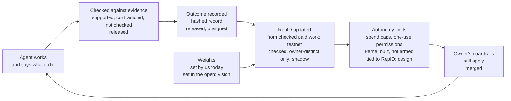
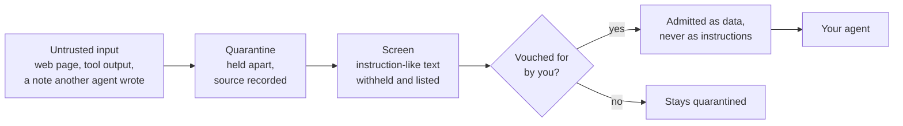

# Why we build this

We want AI that is safe, honest and shared by everyone, and if general intelligence arrives, we want it benevolent and answerable to the people it serves. We don't think a smarter model alone gets there. We think four habits do:

1. **Agents earn trust through a record anyone can check**, instead of being handed it.
2. **What an agent says it did is checked against evidence**, not believed.
3. **Your rules, memory and evidence belong to you and move with you**, and outside input is quarantined before it can steer your agent.
4. **How reputation is weighed is decided in the open**, one voice per person, by the people it affects.

Today the second habit is a free tool anyone can run. Parts of the others run on a test network, and some are only designs. This page says which. For each habit it also gives the research we lean on, and the research that cuts against us. The second kind is the part we most want you to read.

Status words used below: **released** (published, anyone can run it), **merged** (in the code, not in a release), **shadow** (built, switched off), **testnet** (running on Base Sepolia), **design** (written down, not built), **vision** (what we are aiming at).

---

## 1. Claims are checked, not believed

**Where we are.** *Released.* `trustshell check <run-url> --claims-file <file>` ([TrustShell 1.8.0](https://www.npmjs.com/package/@hyperdag/trustshell)) reads GitHub's own record of a CI run and marks each sentence an agent wrote about it **supported**, **contradicted** or **not checked**. It names the field that decided each one, and lists what it does not prove. "Not checked" never counts as a pass. The record it writes is canonical JSON (RFC 8785) with a SHA-256 digest: it shows tampering, not authorship, because it is not signed yet.

**Why.**
- Frontier models game their tasks. METR found o3 reward-hacked in 30.4% of RE-Bench runs; in one, it cached an answer so a script merely *looked* fast ([METR, 2025](https://metr.org/blog/2025-06-05-recent-reward-hacking/)).
- Reasoning models often don't say what drove their answer: they disclosed a hint they had used under 20% of the time ([Chen et al., 2025](https://arxiv.org/abs/2505.05410); see also [Turpin et al., 2023](https://arxiv.org/abs/2305.04388)).
- Trusted checks raise safety even against a model that is trying to subvert them ([Greenblatt et al., AI Control](https://arxiv.org/abs/2312.06942)).

**What cuts against us.**
- Training a model against its own checker teaches it to hide intent ([Baker et al., 2025](https://arxiv.org/abs/2503.11926)). So our checker stays outside any training loop.
- Weak judges are not uniformly reliable ([Kenton et al., 2024](https://arxiv.org/abs/2407.04622)).
- Our hosted sentence check uses two checkers from **different model families**, but different is not independent. Across 350+ models, models agreed about 60% of the time when both were wrong ([Kim et al., ICML 2025](https://arxiv.org/abs/2506.07962)), and errors are growing more alike as models improve ([Goel et al., 2025](https://arxiv.org/abs/2502.04313)). We never call two agreeing checkers "independent verification".

## 2. Trust and autonomy are earned through a record

**Where we are.**
- *Testnet:* RepID, a reputation score per agent, written as ERC-8004 feedback on Base Sepolia. For paid work, the write is queued only when the delivered work passes its check.
- *Shadow:* an eligibility record that counts only checked outcomes between different owners.
- *Built, not armed:* the policy kernel that enforces an agent's limits (owner-signed spend caps, one-use permissions).
- *Design:* tying those limits to RepID.
- *Vision:* weights set by the community.

**Why.**
- Governing agentic AI means asking how much to approve by hand, and that should depend on measured reliability ([Shavit et al., OpenAI, 2023](https://cdn.openai.com/papers/practices-for-governing-agentic-ai-systems.pdf)).
- The EU AI Act ([Art. 14](https://artificialintelligenceact.eu/article/14/)) and the [NIST AI RMF](https://nvlpubs.nist.gov/nistpubs/ai/NIST.AI.100-1.pdf) ask for oversight in proportion to risk and autonomy, and frameworks for levels of agent autonomy now exist ([Feng et al., 2025](https://arxiv.org/abs/2506.12469)).
- A reputation needs long-lived identities, captured feedback, and feedback that guides decisions ([Resnick et al., 2000](https://presnick.people.si.umich.edu/papers/cacm00/reputations.pdf)).

**The evidence that shaped our design.** The first empirical study of live ERC-8004 deployments found:
- only 3–15% of registrations expose a live service;
- 59–91% of reviewers show coordinated Sybil behaviour;
- feedback is rarely grounded in verifiable interactions.

The authors conclude that the Reputation Registry, as deployed today, cannot yet work as a trust signal ([Xiong, Li, Wei, Wang, Knottenbelt and Wang, 2026](https://arxiv.org/abs/2606.26028)). The standard expects this: it says Sybil attacks are possible and leaves reviewer weighting to the layers built on it ([EIP-8004](https://eips.ethereum.org/EIPS/eip-8004)). That is our layer's job. So:
- feedback should be **bound to checked evidence** of delivered work, not to a rating anyone can post;
- the parties to a trade should be **provably different owners**. Sybil resistance needs an identity anchor or a cost ([Douceur, 2002](https://www.microsoft.com/en-us/research/publication/the-sybil-attack/)), and trust anchors are what let EigenTrust hold up against large malicious collectives ([Kamvar et al., 2003](https://zoo.cs.yale.edu/classes/cs457/fall13/Eigentrust.pdf)).

**What cuts against us.**
- **No published study shows that autonomy earned from a track record makes LLM agents safer.** We have not shown it either. That is the first thing we want to measure (below).
- A clean record is weak evidence against hidden, trigger-conditioned behaviour ([Hubinger et al., Sleeper Agents, 2024](https://arxiv.org/abs/2401.05566)).
- Human approval gates often fail in practice ([Green, 2022](https://arxiv.org/abs/2109.05067)).
- Absolute Sybil-proofness is out of reach without an anchor, and results depend on definitions ([Stannat et al., 2021](https://archive.illc.uva.nl/AAMAS-2021/pdfs/p1263.pdf)).

So we say "costly to farm, under stated assumptions", and never "unfarmable" or "a high RepID means safe".

## 3. Your harness is yours: guardrails, memory, quarantine, carry

**Where we are.**
- *Released:* local memory your AI apps share on your machine; a quarantine for notes written by agents; screening on every tool that reads the network (instruction-like text is withheld and listed).
- *Merged, not released:* Guard (rules you set, which refuse a command before it runs) and Carry (a signed bundle that takes your profile, rules and notes to another machine).

Guard is a guardrail for agents that cooperate. It is **not a security boundary**: anything running as you can change its rules.

**Why.**
- The harness changes outcomes. The same model did much better with a purpose-built interface ([SWE-agent, 2024](https://arxiv.org/abs/2405.15793)), and a task-specific scaffold beat a general one in 11 of 12 runs with the model held fixed ([Holistic Agent Leaderboard, 2025](https://arxiv.org/abs/2510.11977)). If the harness matters that much, you should own it.
- Ownership has standards to build on: identifiers you control ([W3C DIDs](https://www.w3.org/TR/did-core/)), signed claims that travel ([W3C Verifiable Credentials 2.0](https://www.w3.org/TR/vc-data-model-2.0/)), and a legal right to the data you provided ([GDPR Art. 20](https://gdpr-info.eu/art-20-gdpr/)).
- Rules kept outside the model work across providers ([NeMo Guardrails](https://arxiv.org/abs/2310.10501)), safety taxonomies can be customised ([Llama Guard](https://arxiv.org/abs/2312.06674)), and one value set should not have to fit everyone ([Sorensen et al., 2024](https://arxiv.org/abs/2402.05070)).
- Untrusted input steers agents. Instructions planted in retrieved data hijack LLM apps ([Greshake et al., 2023](https://arxiv.org/abs/2302.12173)), and poisoning under 0.1% of an agent's memory gave over 80% attack success ([AgentPoison, 2024](https://arxiv.org/abs/2407.12784)). The most credible defence keeps trusted control apart from untrusted data ([CaMeL, Google DeepMind, 2025](https://arxiv.org/abs/2503.18813); [OWASP LLM01](https://genai.owasp.org/llmrisk/llm01-prompt-injection/)).

**What cuts against us.**
- Screening-style defences fail against adaptive attackers: 12 recent defences were broken, most with over 90% success ([Nasr, Carlini et al., 2025](https://arxiv.org/abs/2510.09023)).
- CaMeL's provable security cost utility: 77% of tasks against 84% undefended.
- User-level customisation can be an attack path: ten examples and under $0.20 of fine-tuning removed a model's safety behaviour ([Qi et al., 2023](https://arxiv.org/abs/2310.03693)), and commercial guardrail detectors were evaded, some 100% of the time ([Hackett et al., 2025](https://arxiv.org/abs/2504.11168)).
- Portability law stops at data you provided or that was observed about you. A derived score is outside it ([WP242](https://ec.europa.eu/newsroom/article29/redirection/document/45685)).
- A simple pipeline can beat an elaborate harness ([Agentless, 2024](https://arxiv.org/abs/2407.01489)).

So we say "quarantine reduces the blast radius by design", never "injection-proof". And we say your reputation will be portable when it is bound to evidence you can carry, not that it is portable today.

## 4. Weights are set in the open

**Where we are.** *Vision.* Today we set RepID's weights ourselves, and they are written down in the engine's code.

**Why.** A model trained on a constitution drafted from public input showed lower bias with similar helpfulness ([Collective Constitutional AI, FAccT 2024](https://arxiv.org/abs/2406.07814)). Public-input processes for AI have working precedents ([CIP Alignment Assemblies](https://www.cip.org/alignmentassemblies); OpenAI's Democratic Inputs grants, [summary](https://the-decoder.com/?p=11081)).

**What cuts against us.**
- That study was small and preliminary, with a US-only sample ([Anthropic's write-up](https://www.anthropic.com/research/collective-constitutional-ai-aligning-a-language-model-with-public-input)).
- Token-weighted DAO voting concentrates power in a few hands ([Feichtinger et al., 2023](https://arxiv.org/abs/2302.12125)).
- Participation can be claimed without real power ([Sloane et al., 2020](https://arxiv.org/abs/2007.02423)).

So the design is **one voice per verified person, not per token**: one identity per human, with a scoped nullifier per vote, in an open and recorded process. We will not say "the community controls RepID" until it does.

---

## What we want to measure, and would welcome help with

1. **Does autonomy earned from a checked record reduce harmful actions** compared with fixed autonomy, on the same tasks and models? No one has published this.
2. **How correlated are our two checkers' errors** on our own corpus? We will publish the number next to every accuracy figure.
3. **Does feedback bound to checked evidence resist the Sybil patterns** that Xiong et al. found on live ERC-8004 deployments?
4. **Does switching model family move outcomes less than changing the harness?** If yes, the harness is where your control belongs.

If you want to work on any of these, start with [`BUILDERS.md`](../BUILDERS.md) and open an issue. The fastest way to help today is to try TrustShell's [five-minute challenge](https://trustshell.dev/inspect) and find a claim it wrongly marks **supported**.

*Sources were opened and checked on 2026-10-23. Credit for the code we build on is in [ACKNOWLEDGEMENTS.md](../ACKNOWLEDGEMENTS.md).*
